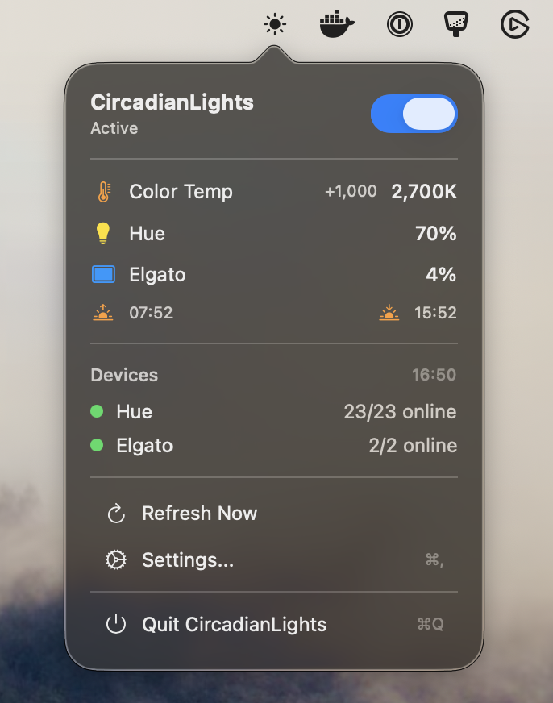

# CircadianLights

CircadianLights is a macOS menu bar app for people who spend their working day on camera in a room with a window. It keeps Philips Hue bulbs and Elgato Key Lights on a single color temperature that follows the daylight outside, so your face, the room behind you and the window in the shot are lit by something like the same light all day.

The app exists because a key light set once only looks right for part of the day. Leave it warm in the morning and you turn tangerine against the blue daylight in the window; leave it cool into the evening and you look washed out while the light outside goes amber. Fixing that by hand means retuning every light several times a day, in two vendors' apps, so CircadianLights recalculates the target and sends it to every light once a minute.



## How it works

The app measures the day from an hour before sunrise to an hour after sunset at your location, so it stretches and shrinks with the seasons, and shapes that span with a sigmoid-transformed cosine, so the lights ease away from their night settings instead of stepping between time slots. By default the color temperature runs from 2700 K at night to 6500 K midway through the day. Open-Meteo's cloud cover can add up to 1000 K on top of that, because overcast daylight is cooler than direct sun, and if the app can read a Pro Display XDR's ambient light sensor, it blends up to 35% of the color the sensor measures into the daytime target. Hue bulbs and Key Lights then receive that same target, limited to each device's range: 2000–6500 K for Hue and 2900–7000 K for Key Lights.

Brightness is handled separately, because a bulb lighting the room and a panel lighting your face do different jobs. Hue bulbs follow the day curve between 60% and 100% by default, with Open-Meteo's solar radiation forecast contributing up to 30% around midday. Key Lights run from 4% to 100% and depend on how much daylight there is, because the curve Hue uses would hold them at about three-quarters power on an overcast December midday. They follow the sensor's lux reading when there is one and otherwise the radiation forecast, which brings that same midday down to about 9%; [radiance.md](radiance.md) explains the formula. With weather turned off and no sensor, they fall back to the day curve.

## Getting started

You need macOS 14 or later and a Hue Bridge or Elgato Key Light on your local network.

1. **Install the app.** Download `CircadianLights.dmg` from the [v1.0.0 release](https://github.com/chrischabot/CircadianLights/releases/tag/v1.0.0), open it and drag CircadianLights to Applications. That build predates the ambient sensor support and the radiation-based Key Light brightness described above. To get them, build from source with a Swift 6 toolchain (Xcode 16 or later):

   ```bash
   git clone https://github.com/chrischabot/CircadianLights.git
   cd CircadianLights
   swift build
   .build/debug/CircadianLights
   ```

2. **Connect your lights.** Click the sun icon in the menu bar, choose **Settings…** and open **Devices**. The app does not discover devices, and a new install is pre-filled with addresses from the author's network, so replace them with your own: [discovery.meethue.com](https://discovery.meethue.com/) reports your bridge's address, and your router's client list shows the Key Lights'. For Hue, enter the bridge's IP address, press the button on the bridge and click **Connect**. For Key Lights, delete the two existing entries and add each light's IP address. If macOS asks for local network access, allow it.

3. **Check your location.** **General** shows the location the app detected from your IP address. If it is wrong, as it may be on a VPN, use **Search City**. A searched city lasts until you quit, because every launch detects the location again. If detection fails, the app uses San Francisco's sun times and skips weather until you search for a city.

4. **Turn it on.** Use the switch in the popover, or right-click the sun icon. The app starts inactive at every launch, even with **Launch at Login** enabled. While it is active, every update also switches on each enabled light, so a light you turn off by hand comes back at the next update; to keep one off, use its toggle under **Devices**, which switches it off and removes it from updates.

**Curves** charts today's brightness and color temperature and sets their limits, **General** sets the update interval, from 30 seconds to 5 minutes, and **Advanced** holds the sensor settings.

## Technical details

Lights are controlled over plain HTTP on your local network: Hue through the bridge's [REST API](https://developers.meethue.com/develop/hue-api/), Key Lights through their [community-documented API](https://github.com/adamesch/elgato-key-light-api) on port 9123. Three outside services are involved. Your IP address goes to ip-api.com at launch, your coordinates go to Open-Meteo for weather forecasts, and any city you search for goes to Apple's geocoder. Sunrise and sunset are calculated locally. The sensor is read through IOKit HID and polled once a second.

## Development

```bash
swift build              # debug build
swift build -c release   # release build
```

Run `.build/debug/CircadianLights` from a terminal to see each update logged. The curve math lives in `Sources/Models/CircadianCurve.swift`, the update loop in `Sources/Models/AppState.swift` and the device, weather, location and sensor clients in `Sources/Services/`. [CLAUDE.md](CLAUDE.md) covers the architecture and code conventions, and [PLAN.md](PLAN.md) is the original plan, with notes on both device APIs; parts of it, such as device discovery, were not built.

`Scripts/build-dmg.sh` builds, signs, notarizes and packages a DMG into `dist/`. Its `SIGNING_IDENTITY` and `NOTARIZATION_PROFILE` belong to the author's Apple Developer account, so change them first.

## Credits

- [Solar](https://github.com/ceeK/Solar) (MIT) calculates sunrise and sunset.
- Weather data by [Open-Meteo.com](https://open-meteo.com/) ([CC BY 4.0](https://open-meteo.com/en/licence)), fetched with [OpenMeteoSdk](https://github.com/open-meteo/sdk) (MIT).
- [ip-api](https://ip-api.com/) provides the IP-based location; its free endpoint is limited to non-commercial use.
- The Key Light protocol is documented by the community project [adamesch/elgato-key-light-api](https://github.com/adamesch/elgato-key-light-api).

## License

This repository has no license file, so no open-source license has been granted. Solar and OpenMeteoSdk remain under their own MIT licenses.
